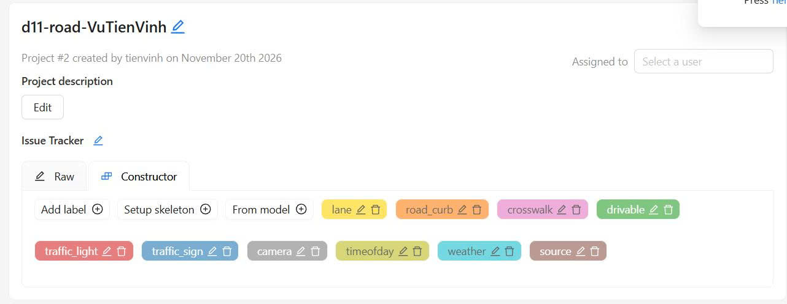
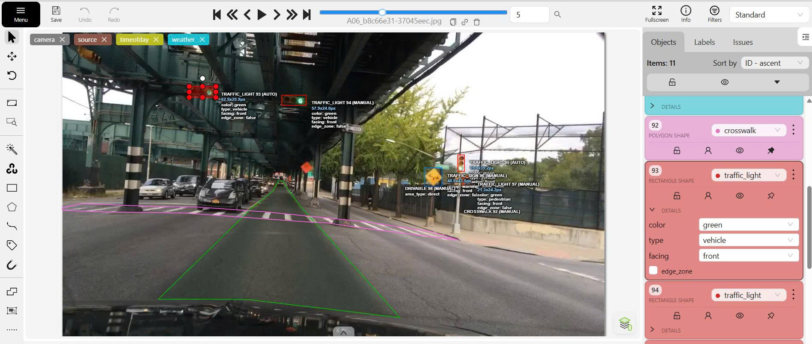
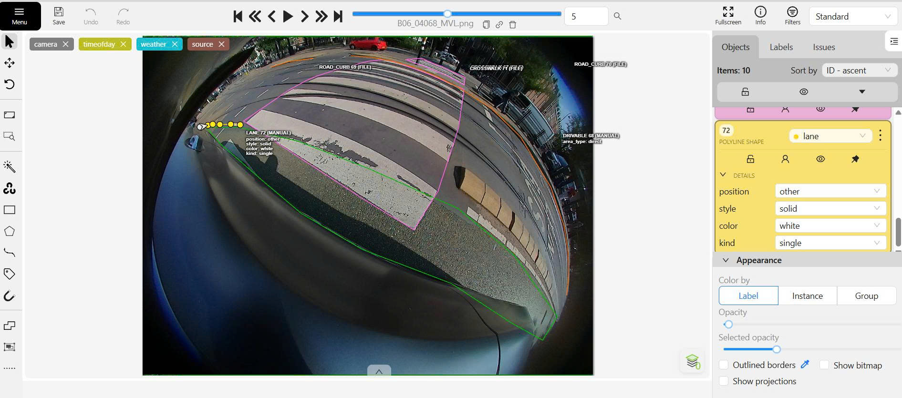
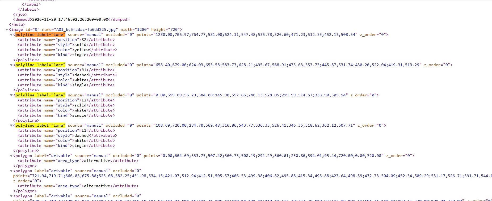

# Báo cáo cá nhân — Ngày 11: Road Elements & SVM

**Họ tên:** Vũ Tiến Vinh. **Mã học viên:** 2A202603269.

**Ngày thực hiện:** 20/11/2026. **Guideline:** Road v1.0.

**Phiên bản CVAT:** 2.74.1, theo thông tin đã ghi nhận trong quá trình thực hành.

**Trạng thái job:** đã **completed** và hai ZIP đã được export từ CVAT, theo xác nhận của học viên. Báo cáo này sử dụng các file đã xuất, không kiểm tra lại hoặc thay đổi job trên CVAT.

**Lần nộp:** revision **5** theo [vinh-manifest.json](../submissions/vinh/vinh-manifest.json), cập nhật cả hai ZIP mới nhất sau sửa. Các bản trước được giữ trong `submissions/vinh/r1/` đến `r4/`.

**Chốt bản bàn giao:** học viên quyết định nộp bộ revision 5 hiện tại và giữ nguyên các cảnh báo lint còn lại. Các vị trí không thấy vạch được giải trình trong báo cáo; xác nhận ngoại lệ và kết luận chất lượng cuối cùng thuộc coach/người kiểm. Không ghi bộ nhãn đã được Release khi chưa có kết luận kiểm lại.

**Thời điểm export theo trường `dumped` trong XML, giờ Việt Nam (UTC+7):** front lúc **00:46:02**, fisheye lúc **00:45:41**, ngày **21/11/2026**. Thời điểm tạo manifest mới được ghi trong `created_at` của manifest. Bài thực hành và lượt QC ban đầu thực hiện ngày 20/11/2026.

Báo cáo sử dụng hai file export của Vinh để thống kê bài cá nhân, [phiếu Lê Văn Khởi kiểm bài Vinh](../submissions/vinh/received-qc/levankhoi-qc1-for-vinh.md) để phản hồi QC nhận được và [Phiếu QC 1 tôi kiểm Khởi](qc1_form.md) để tổng hợp lượt kiểm bài bạn. Hai lượt kiểm có phạm vi và số liệu riêng, không gộp lỗi hoặc mẫu số.

## 1. Kiểm project

| Mục | Đúng như guideline Road v1.0? | Ghi chú |
| --- | --- | --- |
| 6 label, đúng kiểu | Đúng trong khai báo của hai file export | lane, road_curb: polyline; drivable, crosswalk: polygon; traffic_light, traffic_sign: rectangle. |
| Thuộc tính và giá trị | Đã có bộ thuộc tính; cần tiếp tục rà nội dung từng nhãn | lane có position/style/color/kind; drivable có area_type; đèn có color/type/facing/edge_zone; biển có group/facing/edge_zone. Giá trị thuộc taxonomy chưa bảo đảm đúng nội dung ảnh. |
| 4 tag ảnh | Đủ trong 24 ảnh có nhãn; 4 ảnh fisheye-extra còn trống | camera, timeofday, weather, source dùng thuộc tính value; các ảnh bắt buộc đủ tag. B09–B12 có trong export mới nhưng chưa làm, không tính điểm thưởng. |

**Cách kết thúc polyline:** nhấn **N** sau khi đặt điểm cuối; sau đó kiểm tra thuộc tính trong Details và nhấn Ctrl+S. Polyline lane phải đi từ gần xe ra xa; vạch đứt vẫn là một polyline, không tách theo từng đoạn sơn.

**Cách đặt tag:** dùng công cụ Tag, gắn camera trước rồi timeofday, weather, source; mở Details để kiểm tra value. Các tag được tạo tự động hoặc mang giá trị mặc định vẫn phải đối chiếu bằng mắt.

Trong quá trình thực hành, tôi đã tìm hiểu công cụ tự gán tag, detector đèn/STOP và SAM. SAM hỗ trợ phân vùng theo điểm gợi ý nhưng không tự hiểu direct/alternative; vì vậy tôi chuyển sang tự vẽ và kiểm thuộc tính theo guideline. Ảnh được xử lý trên CVAT local, không đưa lên app.cvat.ai.

## 2. Số lượng đã gán

Số liệu sau được đếm trực tiếp từ bản export của **Vinh**, không lấy từ ZIP của Khởi.

| Task | Số ảnh trong bản export | lane | road_curb | crosswalk | drivable | traffic_light | traffic_sign |
| --- | ---: | ---: | ---: | ---: | ---: | ---: | ---: |
| front — A01–A12 | 12 | 30 | 4 | 3 | 24 | 20 | 2 |
| front-extra — A13–A16 | 4 | 2 | 0 | 0 | 3 | 6 | 0 |
| fisheye — B01–B08 | 8 | 5 | 17 | 10 | 6 | 5 | 3 |
| fisheye-extra — B09–B12, chưa làm | 4 | 0 | 0 | 0 | 0 | 0 | 0 |
| **Tổng bản ghi ảnh trong ZIP** | **28** | **37** | **21** | **13** | **33** | **31** | **5** |

- Hai nhóm bắt buộc có **20 ảnh đã có shape**, tổng **129 shape và 80 tag**.
- Nhóm front-extra có shape ở **3/4 ảnh** (A13, A14, A16); A15 mới có tag. Có shape không đồng nghĩa hoàn thành toàn bộ yêu cầu hoặc đủ điều kiện điểm thưởng, nên chưa xác nhận số ảnh thêm đạt.
- Tổng cả hai ZIP là **140 shape và 96 tag**. Bốn ảnh fisheye-extra có bản ghi nhưng chưa có shape hoặc tag, không tính đã làm.

## 3. Bảng ca khó

Các lựa chọn thực tế của bài Vinh được ghi theo bản export; các câu hỏi phát sinh khi kiểm Khởi được ghi rõ nguồn. Ca chưa có lời đáp lead không được xem là đã giải quyết.

| Ảnh / nguồn | Nhãn | Phân vân giữa | Đã chọn / tình trạng | Lý do và việc cần làm |
| --- | --- | --- | --- | --- |
| A05–A08 — bài Vinh | lane | Không có vạch sơn nhìn thấy hay còn thiếu nhãn | Học viên xác nhận không thấy vạch ở các bên bị cảnh báo; chờ coach xác nhận ngoại lệ | Sáu cảnh báo: A05 thiếu L1/R1, A06 thiếu L1/R1, A07 thiếu L1, A08 thiếu L1. Không tạo vạch không có bằng chứng chỉ để hết lint. A09/A10 hiện đã có đủ L1/R1 theo kiểm tra thuộc tính. |
| A06 — bài Vinh | drivable | Phần làn đang đi hay toàn bộ mặt đường dưới cầu | Đã có một polygon direct; ranh giới cần tiếp tục rà | SAM có thể chọn nhiều làn cùng lúc; cần tự xác định làn đang đi, cắt capô/vỉa hè và không khoét lỗ quanh xe khác. |
| A03 — bài Vinh | lane position | L1/R1/L2/R2 theo làn xe camera | Bản revision 4 có R2, R1 và đã bổ sung L1 | Hết cảnh báo thiếu L1 ở A03; các thuộc tính trong phiếu nhận đã khớp hướng sửa. Chưa có phiếu Release sau sửa. |
| B06–B08 — bài Vinh | lane position | L1/R1 hay other ở camera bên | Đã đổi sang other trong bản export revision 2 | Thuộc tính phù hợp quy tắc camera bên; chưa đồng nghĩa đường vẽ đã bám cung hoặc đúng đối tượng. |
| B02, B06 — bài Vinh | edge_zone, polyline | Vùng mép ảnh và số điểm cần cho cung cong | Bản revision 5 hết cảnh báo edge_zone; lane B06 có 6 điểm, còn 3 gợi ý road_curb ít điểm | Học viên đã rà cung cong. Gợi ý số điểm không tự chứng minh sai hình; đoạn ngắn gần thẳng có thể ít điểm nếu vẫn bám mép đúng. Chưa có đo độ lệch với GT. |
| A10 — bài Vinh | lane R1 | Chiều gần ra xa | Đã đảo về đầu (776,437), cuối (766,427) trong revision 5 | Hết cảnh báo chiều vẽ ở A10. |
| A03–A05 — khi kiểm Khởi, M1 | weather, timeofday | clear/overcast và day/dusk | Chờ lead | Giá trị hợp lệ trong taxonomy chưa chứng minh đúng thời tiết/ánh sáng; cần chốt từng ảnh và cách ghi mức lỗi. |
| A05, A06 — khi kiểm Khởi, M2/M3 | lane | Ngoại lệ không thấy vạch, đoạn che hoặc nhãn theo mép xe | Chờ lead | Không chuyển cảnh báo thiếu L1/R1 thành lỗi chắc chắn nếu ảnh không có vạch nhìn thấy. |
| A03 — khi kiểm Khởi, M4 | lane, drivable | Vạch phân làn hay biên dải đỗ; R2/other và alternative | Chờ lead | Cần dựa vào chức năng làn xe chạy; không đưa dải đỗ vào vùng lái của làn đang đi. |
| A06 — khi kiểm Khởi, M5 | traffic_light | WALK trắng ánh xạ unknown/green; side/back | Chờ lead | Taxonomy không có white, nên cần thống nhất quy ước; không lấy kết luận màu đèn ô tô áp cho đèn người đi bộ. |
| A01–A06 — khi kiểm Khởi, M6 | Phạm vi label | Nhóm bắt buộc cho từng ảnh | Chưa có bảng kế hoạch từ slide | Chỉ kết luận bỏ sót đối tượng khi đã xác nhận nhóm label thuộc yêu cầu của ảnh. |

## 4. Phiếu QC 1 nhận được và việc kiểm bài bạn

### 4.1. Phản hồi QC nhận được cho bài của tôi

**Bạn kiểm lô của tôi:** Lê Văn Khởi. **Nguồn:** [levankhoi-qc1-for-vinh.md](../submissions/vinh/received-qc/levankhoi-qc1-for-vinh.md), ngày 20/11/2026, guideline Road v1.0.

**Phạm vi:** A01–A06, 6 ảnh, 0 ảnh thêm, **57 nhãn = 33 hình + 24 tag**. Phiếu kiểm `vinh-front.zip` bản ban đầu tôi gửi; người kiểm chưa có manifest để xác nhận revision. Phiếu ghi rõ **không đánh giá bản đã chỉnh sửa trên task 24**, không kiểm fisheye hoặc các ảnh còn lại.

**Kết quả nhận được:** **2 lỗi nặng, 1 lỗi chính, 0 lỗi nhẹ; 4 ca chờ coach.** Tỉ lệ lỗi chính **1/57 = 1,75%**. Người kiểm đề xuất **Rework — trả sửa** vì còn lỗi nặng về position, dù tỉ lệ lỗi chính chưa vượt 5%.

| Mã lỗi | Ảnh / nhãn trong phiếu nhận được | Số lỗi | Đồng ý? / Phản hồi | Đã sửa? / Hướng xử lý |
| --- | --- | ---: | --- | --- |
| QC1-03, nặng | A03, lane ZIP#1 bản đầu; đầu gần (1276,604), ban đầu L1 | 1 | Đồng ý đường bên phải không thể mang L1. | Đã ghi nhận R2 trong bản front export mới, khớp hướng sửa của phiếu. |
| QC1-03, nặng | A03, lane ZIP#3 bản đầu; đầu gần (701,468), ban đầu L1 | 1 | Đồng ý vạch sát bên phải cần R1. | Đã ghi nhận R1 trong bản export revision 2. |
| QC1-09, chính | A03, traffic_sign ZIP#0 bản đầu; hộp (797,314)–(827,343), ban đầu other | 1 | Đồng ý biển cam công trường thuộc warning. | Đã ghi nhận warning trong bản export revision 2. |
| **Tổng theo phiếu nhận** | **Chỉ A01–A06 của bản Vinh ban đầu** | **3** | **2 nặng + 1 chính; không cộng thêm thiếu R1 do cùng lỗi position.** | **Cả ba thay đổi R2, R1 và warning đã ghi nhận trong XML; chưa có phiếu Release sau sửa.** |

`ZIP#n` trong phiếu nhận là thứ tự hình của bản đầu, không phải ID trên CVAT; thứ tự hình trong bản export mới có thể thay đổi. Trạng thái job completed dùng theo xác nhận học viên. Lượt cập nhật này chỉ đọc hai ZIP mới để tạo manifest và ghi nhận thay đổi, không mở lại hoặc sửa CVAT.

**Bốn ca chờ coach trong phiếu nhận được:**

| Ảnh | Nội dung cần xác nhận | Phản hồi của tôi / Tình trạng |
| --- | --- | --- |
| A01 | Ảnh có yêu cầu gán biển xanh chỉ dẫn không? | Cần đối chiếu bảng kế hoạch label của ảnh; chưa có lời đáp coach, chưa cộng lỗi bỏ sót. |
| A04 | Cụm vàng đôi biểu diễn bằng một hay hai polyline? | Cần thống nhất cách biểu diễn theo guideline; người kiểm chưa tính lỗi này. |
| A05 | Không thấy vạch sơn rõ: có được miễn cảnh báo thiếu L1/R1 không? | Đề nghị coach xác nhận ngoại lệ; không tự tạo vạch không nhìn thấy để hết lint. |
| A06 | Ảnh có yêu cầu gán thêm biển ONE WAY và biển cam công trường không? | Chờ xác nhận phạm vi nhóm label; chưa cộng vào lỗi bỏ sót. |

**Phản hồi tổng hợp:** đã cập nhật hai ZIP mới và bộ bàn giao thành revision 5, giữ các bản trước trong r1–r4. Ghi nhận R2, R1 và warning ở A03, cùng L1 được bổ sung; position=other ở B06–B08 vẫn phù hợp. A10 đã đảo chiều, edge_zone đã rà và hết gợi ý lint. Học viên xác nhận không thấy vạch ở những bên còn cảnh báo thiếu L1/R1; đó chưa phải xác nhận miễn của coach. Chưa có phiếu kiểm lại hoặc Release sau sửa.

**Phân biệt với tự kiểm trước đó:** manifest revision 1 đã ghi 19 cảnh báo mức nặng và 13 mức chính trên toàn bộ hai ZIP (kể cả ảnh thêm). Đây là 32 cảnh báo lint, không phải ba lỗi được Khởi xác nhận trên mẫu sáu ảnh; không gộp hai nguồn số liệu thành một tỉ lệ. Các cảnh báo về position camera bên, edge_zone hoặc cung cong fisheye vẫn nằm ngoài phạm vi phiếu nhận này.

**Tự kiểm bản revision 5:** 13 cảnh báo mức nặng, 3 mức chính, 4 mức nhẹ trên 28 bản ghi ảnh, tổng 20. Trong 20 ảnh bắt buộc còn **6 cảnh báo nặng về thiếu vạch và 3 gợi ý chính về road_curb ít điểm**; 7 cảnh báo nặng thuộc ảnh thêm A13–A16, 4 cảnh báo nhẹ thuộc B09–B12 chưa làm. Đây là gợi ý lint, không phải số lỗi so GT. Bản mới hết cảnh báo chiều vẽ, edge_zone, thiếu L1 ở A03, thiếu R1 ở A09/A10 và position camera bên.

Các mục còn lại trong ảnh bắt buộc:

- QC1-02: A05 thiếu L1/R1; A06 thiếu L1/R1; A07 thiếu L1; A08 thiếu L1. Học viên xác nhận không thấy vạch; chờ coach xác nhận ngoại lệ, không tự vẽ thêm.
- QC1-11: B02 road_curb #2 tại (749,361) có 3 điểm, #3 tại (708,363) có 2 điểm; B06 road_curb #2 tại (364,89) có 3 điểm. Đối chiếu bám cung theo ảnh; số điểm ít không đủ để kết luận lỗi hình học.

### 4.2. Phiếu QC tôi thực hiện cho Khởi

**Lô được kiểm:** Khởi - 2A202603290; file `Khoi-font.zip`. **Phạm vi:** chỉ sáu ảnh đầu A01–A06, không chấm phần còn lại hoặc fisheye. Phiếu chi tiết: [qc1_form.md](qc1_form.md).

Mẫu có **67 nhãn = 43 shape + 24 tag**. Kết quả xác nhận: **2 lỗi nặng, 11 lỗi chính, 0 lỗi nhẹ**, còn **6 ca chờ lead**. Tỉ lệ lỗi chính là **11/67 = 16,42%**. Quyết định **Rework** vì còn lỗi nặng và tỉ lệ lỗi chính vượt 5%.

| Mã | Lỗi nặng | Lỗi chính | Nội dung chính trong sáu ảnh của Khởi |
| --- | ---: | ---: | --- |
| QC1-02 | 1 | 0 | A03 thiếu L1 ở vạch vàng còn nhìn thấy. |
| QC1-04 | 0 | 1 | A01 lane L1 vẽ từ xa về gần. |
| QC1-06 | 0 | 1 | A01 lane R1 là vạch đứt nhưng gán solid. |
| QC1-07 | 0 | 7 | A02 đổi nhầm direct/alternative trên hai polygon; bốn crosswalk bao vỉa hè ở A04–A06; drivable A05 tràn capô. |
| QC1-08 | 1 | 1 | A06 đèn xanh hướng về xe gán đỏ; hộp đèn người đi bộ thừa cột/nền. |
| QC1-09 | 0 | 1 | A06 biển cam cảnh báo gán prohibitory. |
| **Tổng** | **2** | **11** | **13 lỗi xác nhận; sáu ca mơ hồ không cộng vào tổng lỗi.** |

Ưu tiên đề nghị sửa màu đèn và L1 còn thiếu, sau đó chỉnh chiều polyline, style, vùng lái, crosswalk, hộp đèn và nhóm biển. Đây là đề nghị sửa của người kiểm; chưa có bản nộp lại của Khởi hoặc lời đáp lead để xác nhận đã sửa.

## 5. Kiểm file export

| File của Vinh | Mở lại được? | Số shape ảnh 1 (job / file) | Số shape ảnh 2 (job / file) | Tag camera có trong XML? |
| --- | --- | --- | --- | --- |
| [vinh-front.zip](../submissions/vinh/vinh-front.zip) | Có, đọc được XML CVAT 1.1; không kèm ảnh | A01: chưa đối chiếu trực tiếp job / **7** | A02: chưa đối chiếu trực tiếp job / **6** | Có; camera=front trên 16 ảnh. |
| [vinh-fisheye.zip](../submissions/vinh/vinh-fisheye.zip) | Có, đọc được XML CVAT 1.1; không kèm ảnh | B01: chưa đối chiếu trực tiếp job / **5** | B02: chưa đối chiếu trực tiếp job / **13** | Có trên B01–B08; B09–B12 là ảnh thêm còn trống. |

Manifest revision 5 ghi `contains_images=false` cho cả hai file; SHA-256 và dung lượng khớp hai ZIP mới. Đây là kiểm tra định dạng và tính toàn vẹn, không thay cho đánh giá chất lượng nhãn.

| Điều kiện trước khi nộp | Tình trạng theo tài liệu hiện có |
| --- | --- |
| Đủ 20 ảnh bắt buộc có nhãn và bốn tag | Có trong hai ZIP đang kiểm. |
| Không còn lỗi nặng / đã được miễn ngoại lệ hợp lệ | Còn sáu cảnh báo thiếu vạch ở ảnh bắt buộc; học viên xác nhận không thấy vạch, coach chưa xác nhận miễn. |
| Mọi job đã completed | Đã completed theo xác nhận của học viên; không kiểm tra lại trên CVAT. |
| Có manifest bàn giao | Có bản revision 5; các bản trước được giữ trong r1–r4. |
| Có Phiếu QC 1 kiểm bạn khác | Có phiếu kiểm Khởi, mẫu A01–A06. |
| Có phản hồi QC nhận được | Đã nhận phiếu Lê Văn Khởi kiểm A01–A06 của bản Vinh ban đầu; phản hồi tại mục 4.1. |
| Minh chứng trong báo cáo | Đã bổ sung 4 ảnh học viên cung cấp: Labels, front A06, fisheye B06 và XML lane; xem mục 6. |

## 6. Ảnh chụp màn hình và minh chứng

Đã nhận và bổ sung bốn ảnh chụp do học viên cung cấp từ thư mục `ảnh lap 11` trong Downloads. Các ảnh được sao chép nguyên bản, không chỉnh sửa nội dung. Đây là minh chứng thao tác và nội dung nhãn, không thay cho kết quả đo sai lệch với GT hoặc xác nhận Release của người kiểm.

### 6.1. Labels của project

Ảnh project `d11-road-VuTienVinh`, thể hiện đủ sáu label hình: lane, road_curb, crosswalk, drivable, traffic_light, traffic_sign; cùng bốn tag: camera, timeofday, weather, source.



### 6.2. Ảnh front A06 đã gán nhãn

Ảnh A06 trên CVAT có bốn tag ảnh, polygon drivable/crosswalk và hộp đèn/biển. Bảng Details của traffic_light đang mở, thể hiện các thuộc tính color=green, type=vehicle, facing=front và edge_zone=false.



### 6.3. Ảnh fisheye B06 và thuộc tính lane

Ảnh B06 từ camera bên thể hiện hình ảnh cong, các đường gán trên ảnh và đối tượng lane đang được chọn. Details hiển thị position=other, style=solid, color=white, kind=single. Các điểm điều khiển của polyline nhìn thấy trên ảnh; việc đánh giá độ bám cung vẫn theo guideline, không kết luận đạt chỉ từ số điểm.



### 6.4. XML export có polyline lane

Ảnh chụp XML thể hiện ảnh A01, các thẻ `<polyline label="lane">`, chuỗi tọa độ points và thuộc tính position/style/color/kind. Có thể thấy L1 mang dashed/white/single, R2 mang solid/yellow/single và các vạch khác trong cùng ảnh.



Đoạn XML trích từ A01 trong file `vinh-front.zip` để tiện đọc:

```xml
<polyline label="lane" source="manual" occluded="0"
  points="0.00,599.89;56.29,584.08;145.98,557.66;248.13,528.05;299.99,514.57;333.90,505.94"
  z_order="0">
  <attribute name="position">L2</attribute>
  <attribute name="style">solid</attribute>
  <attribute name="color">white</attribute>
  <attribute name="kind">single</attribute>
</polyline>
```

Minh chứng cho lượt kiểm Khởi được mô tả bằng mã ảnh, thứ tự shape và tọa độ trong [Phiếu QC 1](qc1_form.md). Kết quả đó thuộc bài Khởi, không trình bày như ảnh chụp hoặc kết quả QC nhận được của bài Vinh.

## 7. Tự đánh giá

Qua thực hành và lượt kiểm bài, tôi nhận thấy cần kiểm cả hình học lẫn ý nghĩa thuộc tính. Một đường vẽ trông hợp lý vẫn có thể sai chiều, sai position hoặc giữ style mặc định. Tương tự, polygon đúng phần mặt đường nhưng gán nhầm direct/alternative sẽ làm sai mục tiêu học của mô hình. Công cụ AI chỉ nên tạo gợi ý, không thay cho việc đọc guideline và kiểm từng ảnh.

Theo phiếu Khởi kiểm bài tôi, lỗi nặng được xác nhận tập trung ở **QC1-03 — position**: hai vạch bên phải A03 bị gán L1. Tôi cần xác định làn xe camera đang đi trước khi đặt L1/R1/L2/R2, rồi kiểm từng hình trong Details. Lỗi chính ở group biển cho thấy cần phân nhóm theo chức năng biển và guideline, không giữ other khi có đủ bằng chứng đây là biển cảnh báo công trường.

Ở phần tự kiểm, bản revision 5 đã hết cảnh báo chiều vẽ và edge_zone. Với sáu cảnh báo thiếu vạch ở A05–A08, tôi thực sự không thấy vạch tại các bên được báo và đề nghị coach xác nhận ngoại lệ. Ba gợi ý road_curb ít điểm cần được đánh giá theo độ bám mép thực tế, không theo số điểm đơn thuần. Những mục fisheye không nằm trong phạm vi phiếu Khởi đã kiểm.

Ví dụ từ lỗi của tôi trong phiếu nhận: vạch sát bên phải A03 bị gán L1 tạo mục tiêu sai cho mô hình phân loại vị trí làn. Tôi đã đổi thuộc tính vạch này thành R1 trong bản revision 2; việc này được ghi nhận từ XML, chưa phải kết luận Release của người kiểm. Trong lượt tôi kiểm Khởi, lỗi đèn xanh gán đỏ và crosswalk bao vỉa hè cũng cho thấy nhãn sai có thể làm mô hình học ngược nội dung ảnh.

Để tránh lặp lại ở Ngày 20, sau mỗi ảnh tôi sẽ kiểm theo thứ tự: bốn tag → vị trí/chiều và thuộc tính lane → biên vùng lái/crosswalk → độ sát hộp và thuộc tính đèn/biển → lưu. Tôi sẽ phóng to đèn trước khi chốt color, không lấy màu overlay làm màu vật thể, ghi ca khó kèm lý do và xin lead xác nhận thay vì suy đoán.

## 8. Hoạt động row-anchor (tùy chọn)

Chưa thực hiện đối chiếu row-anchor trong tài liệu hiện có; không tự điền số liệu hoặc tính điểm cho hoạt động này. Nếu làm thêm, dùng cùng ảnh và position khi so bài Vinh với Khởi, rồi ghi các hàng nội suy và lý do hàng không có làn.

Đã bổ sung phiếu QC nhận được và phản hồi tại mục 4.1, đồng thời cập nhật hai ZIP mới nhất và manifest revision 5. Một số thay đổi đã xác minh bằng XML và lint; trạng thái không thấy vạch do học viên xác nhận, chưa có xác nhận miễn hoặc Release từ coach. Phiếu tôi kiểm Khởi có hỗ trợ đọc XML/đối chiếu ảnh bằng AI, không coi là lời đáp chính thức của coach.

Bốn ảnh chụp minh chứng đã được bổ sung ở mục 6. Khi bàn giao bản Markdown, giữ thư mục ảnh đi cùng báo cáo để người nhận xem được ảnh.
